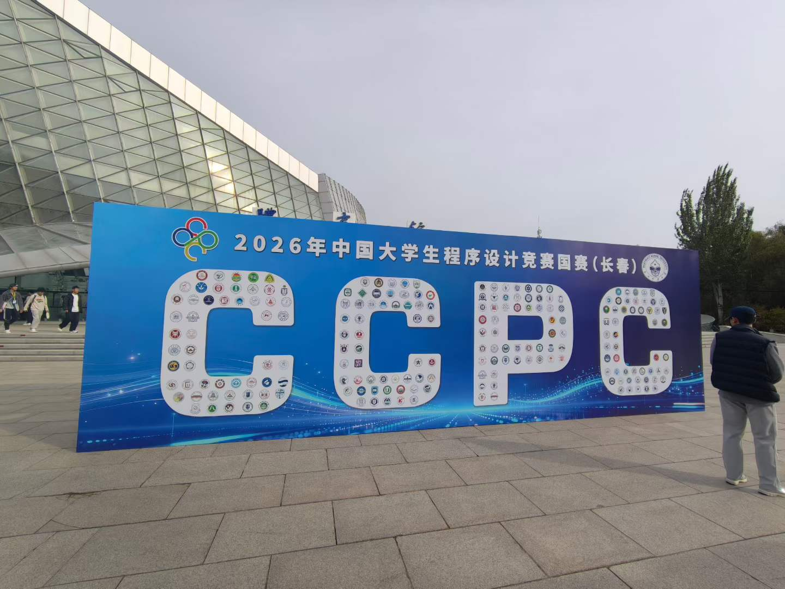
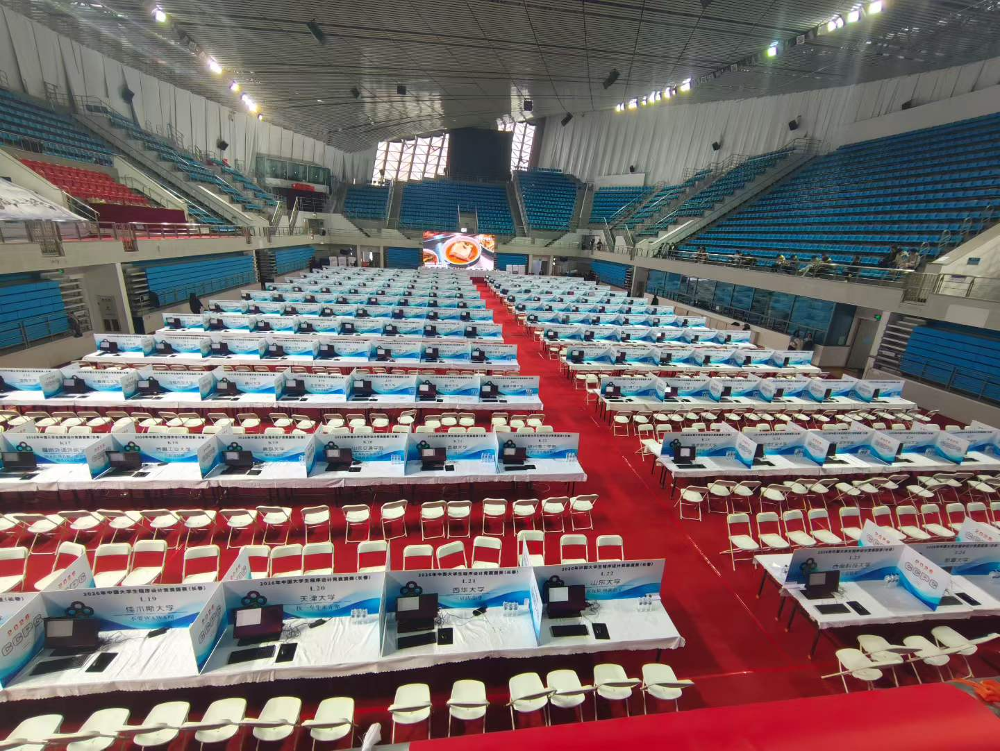
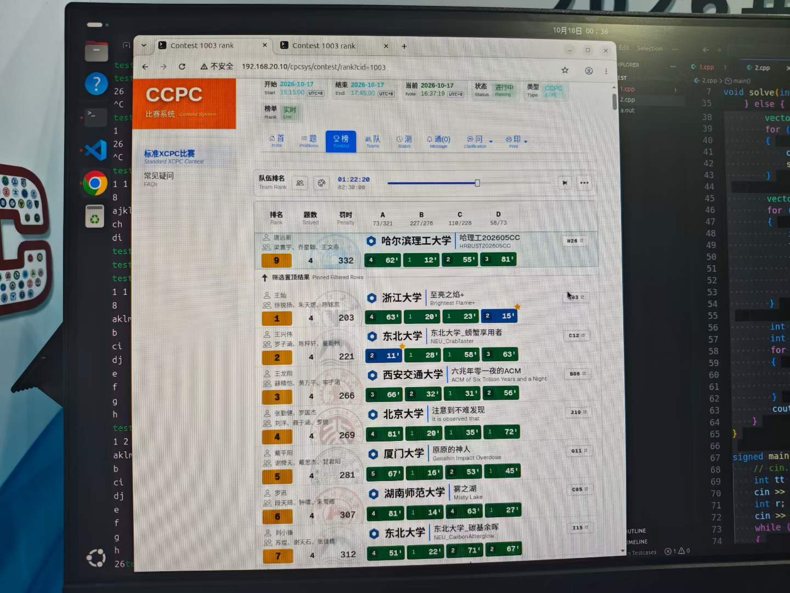
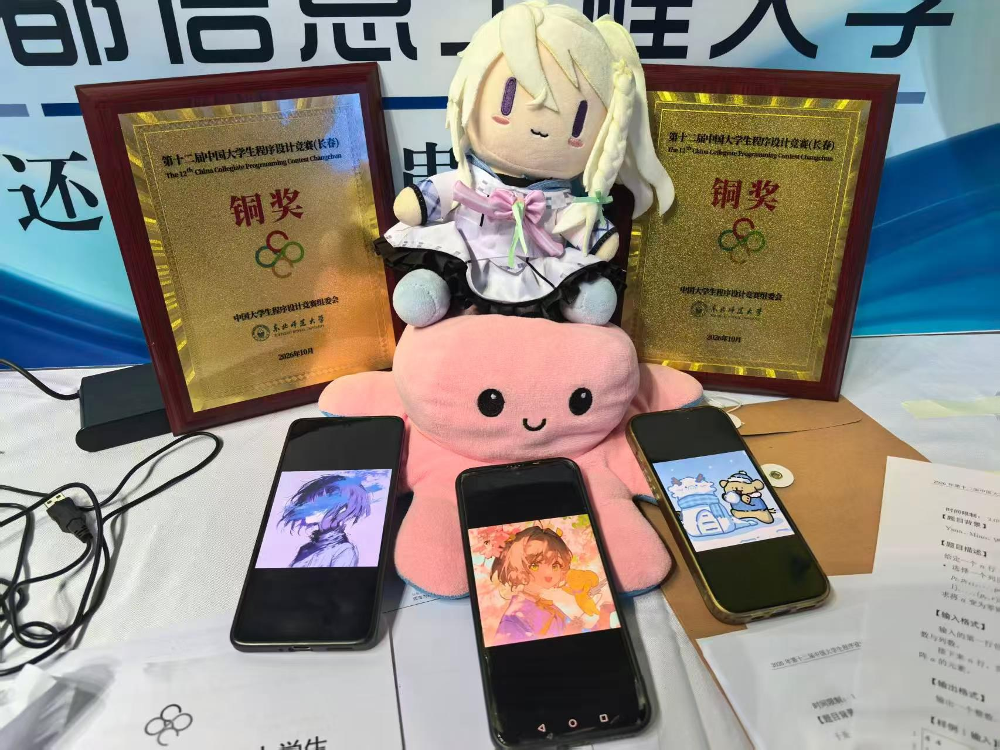
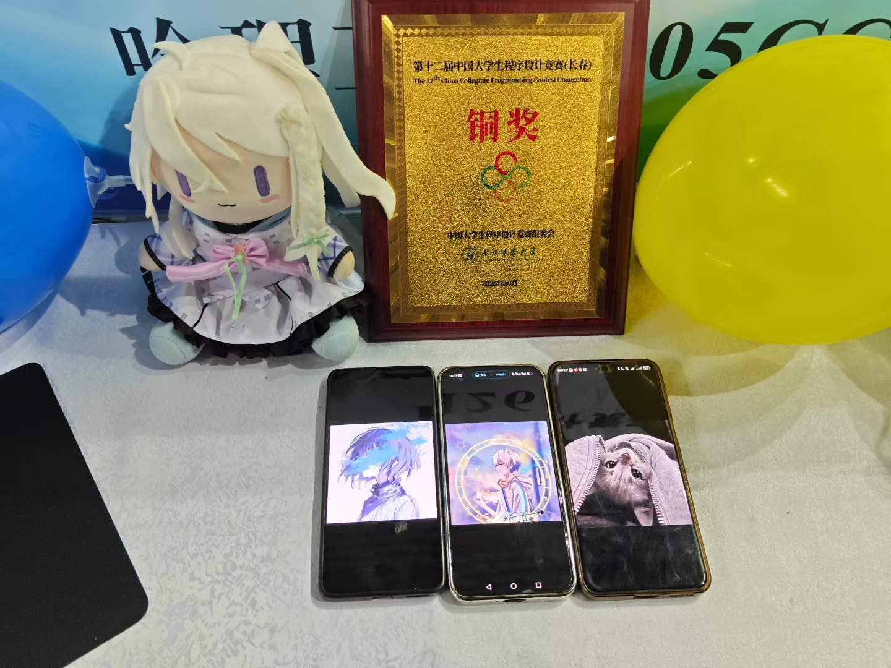
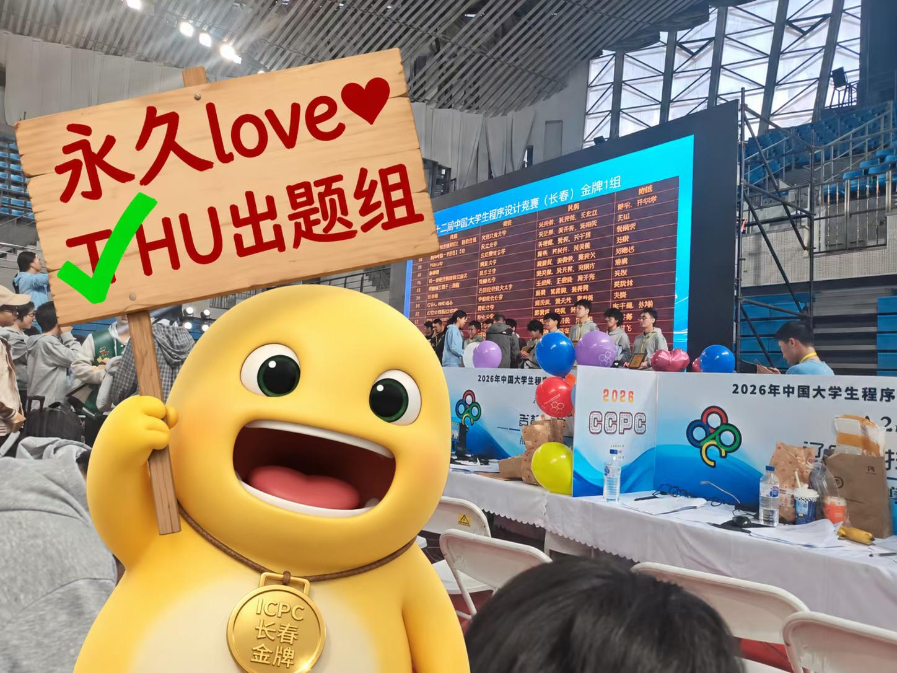
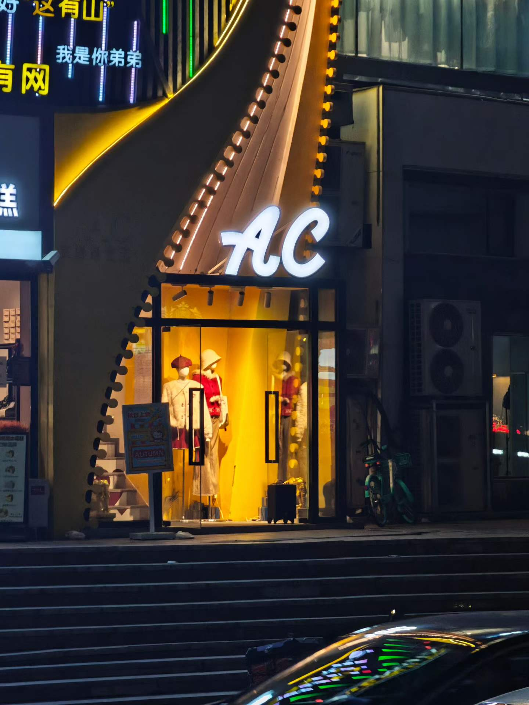
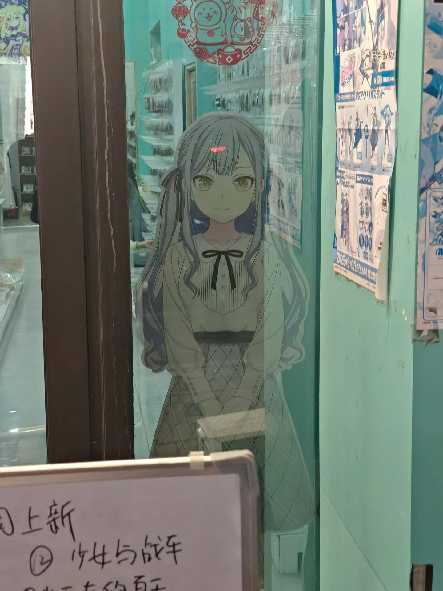
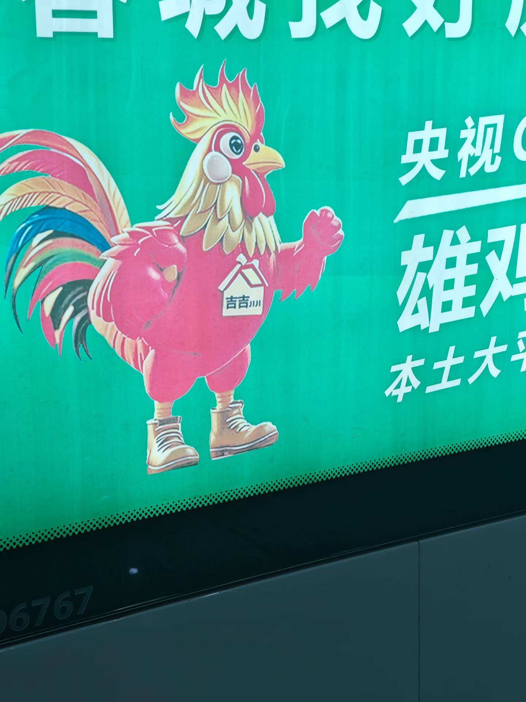

第一次参加区域赛，大二因为太区了没拿到名额 

第一场就拿到铜其实对我来说已经达到大学阶段算法竞赛能取得的至高成就了，相比之下蓝桥杯国一和省赛金是真没含金量啊（笑

感觉银牌没啥戏了，reg的铜银（在大部分场次）还是很有区分度的，这场要想ag我得再做两题 

所以，还是很开心的！

## 热身赛：充分发挥 guessing 和乱搞精神

THU 去年出的上海站题被喷得挺惨，今年开幕式上说“我们已经充分吸取了教训”。结果热身赛还是相当抽象：提交之后 in queue 了半个小时，榜单界面的鉴权也出了问题，再加上题面的表达，现场体验实在算不上顺畅。

好在我们充分发挥 guessing 和乱搞精神，最后侥幸 AK。过程虽然有点混乱，但至少热身的结果还不错。

长春师范的体育馆是真的大，比赛桌铺开以后看着还挺壮观。

开学以来，我的作息一直抽象得厉害，基本上是日落而作、日出而息。为了赶上早上九点的比赛，这次居然十一点就上床休息了，也算是为 ACM 做出了一点作息上的努力。

## 正赛：从以为要铁，到摸到铜牌

这场用了 CCPC 的新赛制。对我来说，很长一段时间里，榜单都不太能拿来判断局势：看到冠军队已经开了七道题，自己能看到解封的却只有两道，实在有点搞心态。像我们这种队，也更难据此判断该把时间投到哪道题上。

我们花了不少时间研究一道题面很短的 mid-hard，以及另一道始终没找到突破口的题。反倒是一道比较签的题，几乎直到封榜后才开始认真看。现在回头看，选题和时间分配确实有点伤。

封榜的时候，我们排在接近 200 名的位置。我当时已经觉得自己要铁了，结果过了两分钟，交上去的一道乱搞题居然过了，名次一下来到 150 左右。于是开始算铜牌线：按我当时的估计，只要前面那一批队伍别有太多继续过题，自己似乎还有机会 Cu。

后面又花了大约一个小时，和队友讨论那道通信题。说是讨论，其实争得还挺厉害，队友都有点着急了，我还让他先别吵。最后感觉我们的思路已经很接近正确答案，但到底差在哪里、是不是真的只差一点，现在也说不准，等赛后补题再试试。

没能把它写出来，当然还是有点遗憾。不过最后能拿铜，已经足够开心了。单说正赛题目，我觉得 THU 这次算是一雪前耻，至少赛后我基本没看到之前那样的吐槽，铜银之间的区分度也做得挺到位。

## 赛后：奖牌、合照，还有一点不甘心

赛后当然要合照。下面这张，中间是银牌选手 ✌🏻welken，只不过他的雷霆大银牌被队友拿走了，就没能一起出镜。

再来一张队内合照。主打一个人可以不出镜，但手机和玩偶必须到位。

路上也拍到了一些奇怪但很应景的东西，比如这个大大的 AC。比赛之外，还是多少留了点闲逛的记录。

差不多就是这样。第一场区域赛拿到铜，感觉都可以提前宣布退役快乐了，毕竟我的追求也没有那么高。或者说，打得越多，就越认识到自己其实还很菜，算法竞赛归根结底还是少数人的游戏啊（悲）。

不过，我后面还有 ICPC 武汉和 ICPC 上海。

说不定就爆种拿 Ag 了呢？说不定呢。😬
