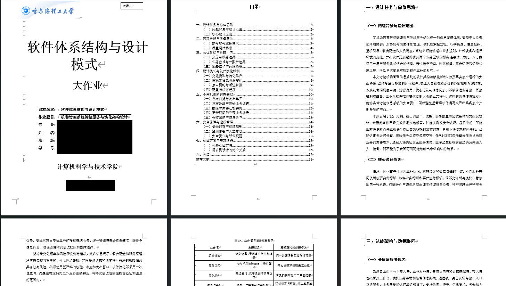
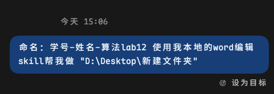
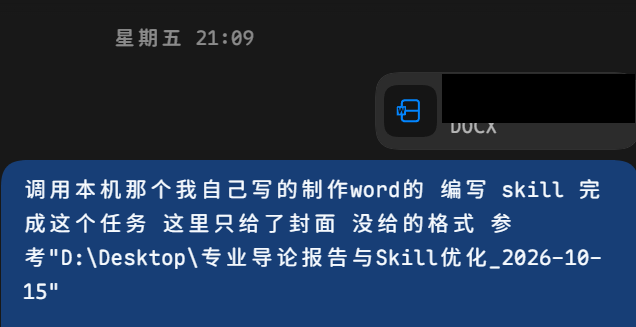

> [!NOTE]
> **观前提示：** 除作者自己的感想外，本文完全由 AI 生成并直接发布。

## 前言

在我 24 年大一入学的时候，AI 技术还尚未像今天一样发达。彼时我为了完成一个对格式要求严苛的课程设计，不得已反复调整格式，为此学会了不少有关 Word VBA 宏的操作知识。

随着时代进步，我们惊喜地发现，Harness 已经可以直接操作电脑了。我由衷地希望，大学生们可以把更多的时间拿去做自己想做的事情，而不是在电脑前面盯着被吹毛求疵的样式反复修改。

为此，我设计了 [project-to-template-report](https://github.com/2258009564/project-to-template-report)，一套“更适合哈理工宝宝体质”的 Word 报告 Skill，其他学校的模板也能用。**需求随口说，模板和材料交给它，等着收报告就行。** 从读要求、写正文，到做图表、审稿和排版，它会按技能里的流程接着完成。

::github{repo="2258009564/project-to-template-report"}

如果用下来觉得好用，欢迎分享给身边也在赶报告的朋友，也可以到 [项目页](https://github.com/2258009564/project-to-template-report) 点个 **Star**，支持一下。

## 使用示例：一次性生成报告 

下面是项目 README 展示的三份**一次性生成的报告成果**，可以简单看看实际的内容和排版效果。

算法设计与分析实验报告：沿用老师的表格模板，完成封面、实验说明、算法描述与代码。


软件体系结构与设计模式报告：封面、目录、分级标题和正文表格，按同一套模板组织。



系统分析与设计课程报告：正文分析、对比表格和系统架构图一起制作、编排。


第一次用 dsh，可以先让 DeepSeek 带你安装、配置和测试，再到 dsh 里交报告任务。**跟着下面两步走就行。**

### 第一步：打开 DeepSeek 网页版，把这段提示词发给它

**都已经是 AI 时代了，装软件、配环境，也让 AI 带着做。** 直接打开 [DeepSeek 网页版](https://chat.deepseek.com/)，把下面的提示词复制发给它，跟着提示一步步把 dsh 配好就行。遇到看不懂的界面，也可以截图问它。

dsh 直接登录 DeepSeek 账号就能使用，付费调用需要账号里有余额。**可以先充 2 元试试：做一份完整的 Word 报告，消耗可以低于 1 元。** 实际费用随模型、篇幅和修改次数变化，以账单为准。

提示词如下：

```text
你现在是我的 DeepSeek Harness（简称 dsh）入门向导。我正在使用 DeepSeek 网页版聊天，请一步步带我完成 dsh 官方桌面端的下载、安装、账号登录、充值和可用性测试，让我最后能直接把本地实验报告任务交给它。

我是新手，请按下面的方式带我操作：

1. 每轮教我做一小步，选一条适合我的操作路线，说清楚打开哪个页面、点击什么、填写什么，以及成功后会看到什么。等我回复结果，再继续下一步。

2. 先问我使用 Windows 还是 macOS，以及现在进行到哪一步。已经完成的步骤直接跳过；如果我已经能在 dsh 里正常使用模型，就直接进入测试。

3. 从官方入口 https://www.deepseek.com/download/ 带我找到 DeepSeek Harness 桌面端并下载安装。告诉我接下来哪些操作在 DeepSeek 网页里做，哪些在 Harness 里做。能联网时先核对当前页面；无法联网时，根据我提供的界面文字或截图指导。

4. 安装后带我直接登录 DeepSeek 账号，选用账号里的模型。接着指导我查看余额，找到充值入口，通过 DeepSeek 开放平台为同一账号充值；余额充足就继续测试。可以先充 2 元体验，按当前页面提供的金额选项操作，支付由我自己完成。根据实际余额更新确认充值结果。需要选择工作区时，先选桌面。

5. 配置后做两项实际测试：先让我在 dsh 发送一条简单消息，确认模型正常回复；再给我一条可复制的指令，让 dsh 在实际的桌面目录创建“dsh测试.txt”，写入“本地文件操作测试成功”。让 dsh 先确认桌面的实际位置，已有同名文件时换个文件名。让我打开文件核对内容，两项都通过才算准备完成。

6. 遇到问题，先看我提供的报错或截图，每次给出一个针对当前问题的处理步骤，再根据结果继续。你在网页里指导，我按提示操作，本地文件测试由 dsh 执行。以实际回复和文件内容判断是否成功。

7. 两项测试通过后，告诉我 dsh 已经配置完成，提醒我回到原教程帖，继续第二步。引导到这里结束。

讲解以眼前的操作为主，报告技能留到教程第二步交给 dsh 处理。现在先问我使用的操作系统和当前进度。
```

### 第二步：到 dsh 发一句话，直接做完报告

前面的向导带你测通以后，打开 dsh 的对话框，把技能仓库地址和材料路径一起丢给它：

```text
部署 https://github.com/2258009564/project-to-template-report 到本地，然后读取 xxxxx 的内容，用这个 Skill 帮我直接完成实验报告，完成版另存到这个文件夹里，保留原模板。
```

**把示例路径换成你电脑上复制出来的真实路径就行。** 文件夹里放老师的模板、实验要求和已有代码、截图等资料；分散在不同位置的，也可以把几个路径一起发给它。有特别要求，就顺口补一句“只做实验二”“封面已填好，别改”或“按学号姓名命名”。





这两张图就是实际提需求的例子。交代材料在哪、想做什么就够了，技能部署、读取模板和后续制作由 dsh 接着处理。

**如果报告必填的姓名、学号、班级等个人信息还不知道，它默认会停下来集中询问，等你回答后再继续。** 已经从材料或本地记录中明确的信息会直接复用。第一次补充时，可以顺手说“这些常用信息可以记在本地，以后做报告直接用”，下次做报告时，它就会先读这些记录。

剩下的时间等它处理，保持电脑开机，有需要确认的提示时按界面处理。完成后打开它给出的 Word 文件，核对题目、个人信息和实验结果；想改哪里，就在原对话里说“心得结合我的代码写具体一点”“这里加一张流程图”，让它接着修改。

**以后再做报告，直接重复第二步：换份材料，说句需求，等它完成。**

关于这个 Skill 的详细介绍、功能和使用示例，都放在 [项目 README](https://github.com/2258009564/project-to-template-report#readme) 里了。下面简要介绍一下它的技术细节。

## 技术细节：技能内部怎样完成这件事

### 读取实际格式，在模板副本上编写

技能通过 Word 自动化读取模板的段落、字体、标题、表格和分节等信息，以实际格式为依据。模板样式名相同，实际字号、缩进或间距也可能不同，因此需要先检查再使用。

正文先按标题、段落、图表等类型整理，再批量写入模板并套用格式。修改在副本上进行，封面和指定保留的区域沿用原样；局部修改则围绕选定内容处理。

### 按任务加载需要的能力

技能入口是 `SKILL.md`，相关规则在 `references`，复用脚本在 `scripts`。普通报告读取对应的模板、内容与验证规则；软件项目报告再结合项目证据，有图示要求时再加载图表制作与检查规则。

dsh 会根据报告内容读取相关说明和调用脚本，仓库地址和材料路径就是这套流程的入口。

### 本地记忆与最终检查

个人信息和反馈单独记在本地，带有来源、日期和适用范围。以后做报告时先读取相关记录，以本次要求为准；这些私人记录与公开技能分开存放。

报告生成后，先核对内容和结构，再把页面渲染出来逐页检查，查看表格、图片和文字的位置。最终分页以 Word 中的实际效果为准。

相关入口：[Word 报告 Skill 与 README](https://github.com/2258009564/project-to-template-report)、[DeepSeek 官方下载](https://www.deepseek.com/download/)、[DeepSeek 开放平台](https://platform.deepseek.com/)。入口按 2026 年 10 月 24 日核对。
